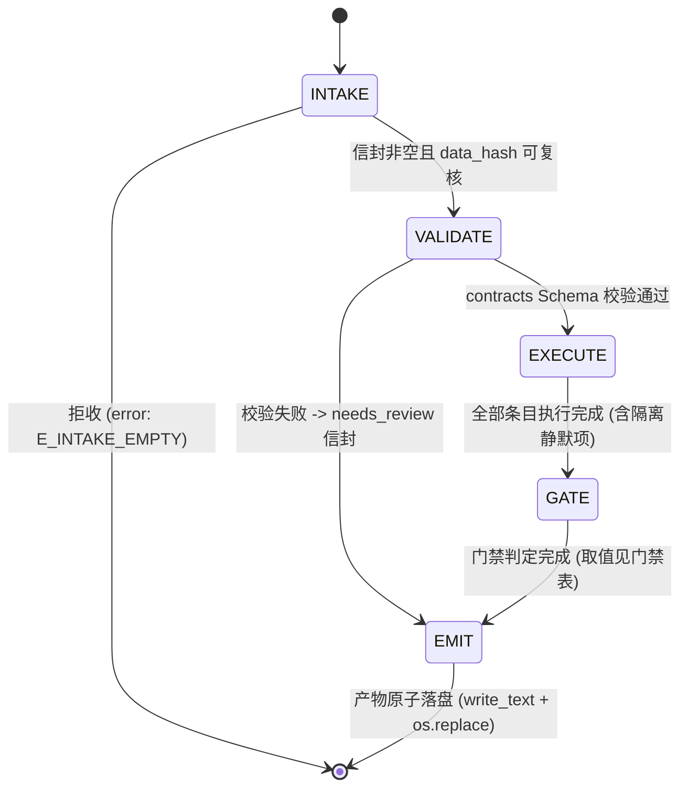

# astro-best 架构规范 — 五状态机 · 失败隔离 · 12 横切治理面

依据: Master Plan §4 组件 3、§2 第 2 行 (黄金模板标准化, Phase 3-D 立档;
后续轮次增量修订, 不设发布版本号 — 变更历史见 CHANGELOG.md, 已入版本控制)。
## 0. 主理定位声明 (BEST 数据源)

> **定位: BEST 数据库的唯一数据源主理方。** 全 ecosystem 只有本 skill 能访问
> `nadc.china-vo.org/data/best` (该站点无 TAP/ADQL/REST-JSON 端点, 只有 Django form
> 两阶段协议); astro-catalog 主理 SIMBAD/VizieR/Gaia 等通用检索, 不具备 BEST 能力。
> 本架构约束的是:
> - BEST 数据的查询/下载/匹配能力边界与失败语义 (越界即委派, 见 SKILL.md 委派表);
> - 两阶段协议是唯一入口, 禁止旁路重实现 canonical 已承接的通用检索/清洗能力;
> - 任何公开函数的行为变更必须连带 `test/` 回归 (不允许行为漂移);
> - import 路径随架构重构演进 (函数能力不变); 变更历史记 `CHANGELOG.md` (已入库)。

## 0.1 治理机制 (README 树 SSOT + 权限矩阵)

> **入口铁律**: 任何 AI Agent 必须先读 `README.md` (逐文件能力边界 + 文件树 SSOT + 治理规则),
> 未建立文件树地图前禁止猜测目录用途或改动结构。
>
> - **文件树 SSOT**: `README.md` 末尾树清单块为唯一 canonical 快照, 由
>   `ops/verify_tree_integrity.py` 生成与校验; 实际树与清单不一致即阻断 (非零退出);
> - **权限矩阵**: 既有文件内容编辑自由; 结构变更 (被跟踪文件/目录增删移改名、
>   .gitignore 增删、树清单变更) 必须经用户明确批准, 批准后 `--write` 重新生成;
> - **临时文件**: 只允许 `temp/` (gitignored); 其他位置临时文件即违规;
> - **禁版本号**: 全仓无发布版本号 (含 schema 标记); 变更只记 `CHANGELOG.md` (已入库);
> - **local-only 目录**: `docs/ temp/ .checkpoints/ .progress/ .logs/`
>   不随 git 分发 (`.progress/` 下载进度、`.logs/` 任务日志为下载能力
>   轮次新增的运行时状态, 经用户批准入 .gitignore)。
>   > 例外: `docs/` 自「六份 eval-E* 实验方案与 docs/architecture 计划需随专用远程
>   > 仓库分发」起已入版本控制; 仅 `docs/diagrams/` 的渲染产物 (PNG/SVG/PDF) 不跟踪。
>   > `CHANGELOG.md` 曾在本名单内 (走 .gitignore), 2026-10-05 改判为**入版本控制**:
>   > 变更历史是删改记录的唯一载体, 留在仓外等于无记录, 新克隆者无从追溯。现在
>   > 不在本名单内。
> - **版本库拓扑 (必读)**: 本 skill 的**权威版本库是 `astro-best/.git`** (独立 git root)。
>   父目录 `G:/tw/twskills` 是另一个 git 仓库, 曾以普通文件模式 (100644, 非 submodule)
>   跟踪 `astro-best/**`, 导致同一批文件被两个仓库跟踪、两边 HEAD 基线分叉
>   (实测同一测试文件父仓 72 行 / 子仓 184 行)。已执行 `git rm -r --cached astro-best`
>   + 父仓 `.gitignore` 收口。**所有 git 操作在本目录内执行, 不要从父目录操作本 skill**;
>   `ops/audit/` 中按 HEAD 比对的工具 (`verify_no_code_loss.py` / `code_fingerprint.py`)
>   曾因 ROOT 指向父仓而读错基线。
> - **文件必须入库**: 磁盘上存在且未被 `.gitignore` 忽略的文件必须 `git add` 入库。
>   树完整性门禁只比对「README 树块 ↔ 文件系统存在性」, **看不见"未跟踪"** ——
>   `ops/audit/` 11 个文件曾长期只在磁盘与树清单里。常驻门禁见
>   `test/unit/meta/test_gate_blindspots.py::TestGitTrackingCoverage`。

## 1. 五状态机 INTAKE → VALIDATE → EXECUTE → GATE → EMIT

### 每状态迁移条件

| 状态 | 职责 | 进入条件 | 离开条件 | 失败出口 |
|------|------|----------|----------|----------|
| INTAKE | 接收输入契约信封 (schema 见 contracts/) | 上游产物到达 | data_hash 齐备 | E_INTAKE_EMPTY 拒收 |
| VALIDATE | input.contract.yaml Schema 校验 | INTAKE 通过 | Schema 零错误 | EMIT(needs_review) + 逐字段错误码 |
| EXECUTE | 按场景路由执行 (manifest on_demand) | VALIDATE 通过 | 全部条目完成/隔离 | per-item try/except 隔离, 不中断批次 |
| GATE | 阻断性门禁判定 (下表) | EXECUTE 完成 | accepted/rejected 落定 | 门禁不足→needs_review, 保留证据 |
| EMIT | 原子写输出契约产物 | GATE 完成 | 成功落盘 | 抛出, 绝无半写 |

### 门禁表 (阻断性)

| 门禁 | 判定 | 阈值 | 单位 |
|------|------|------|------|
| http_status | == | 200 | count |
| checksum_match | == | True | bool |

### 失败隔离

对每条目 (帧/条目/查询) 独立 try/except: 单点异常进该条 `errors` 列表并置
`status="failed"`, 不中断批次; 全灭 → EMIT(errors=[...])。降级必须产生
WARN 级注记并记录于 `rag/knowledge/lessons_learned.yaml` 锚点。

## 2. 12 横切治理面

| # | 治理面 | 含义与锚点 |
|---|--------|------------|
| 1 | provenance 溯源 | 信封携带 session_id + data_hash; 输入路径可复核 |
| 2 | units 量纲 | 量纲随字段走 (见 references/ALGORITHM-SPEC.md 量纲表) |
| 3 | determinism 确定论 | 纯数值路径固定种子; 禁 wall-clock 进数值 |
| 4 | logging 日志 | 每状态 logger; 降级必须 WARN 注记; **任务日志管理器** `src/task_log.py` (.logs/task_log.jsonl, JSONL 事件流 + tail/problems/tasks/summary 视图, 与 .progress/ 分工: 日志答"发生了什么", 进度答"到哪了") |
| 5 | error_codes 错误码 | contracts/error-codes.contract.yaml 枚举; 不静默吞异常 |
| 6 | contracts 契约 | 跨节点 I/O 过 astro-envelope-v1 双态信封 |
| 7 | quality_gates 质量门禁 | 上表阻断性; 不足 → needs_review |
| 8 | delegation 委派 | Out-of-Scope 一律转 canonical (SKILL.md 重定向/委派表) |
| 9 | security 安全 | 凭据只读环境变量; 变量路径 is_relative_to 校验; 无 .. 上溯、无凭据字面量 |
| 10 | reproducibility 可复现 | references/ALGORITHM-SPEC.md 为唯一白盒出处 (五要素) |
| 11 | compute_budget 算力 | 本地 <100 样本点、<1s 单测 (G8); 重负载走 ops/cloud_modelscope |
| 12 | observability 遥测 | 状态迁移与门禁判定可回放 (全库 telemetry 面对齐) |

## 2.1 附加结构治理面 (README SSOT 机制)

| # | 治理面 | 含义与锚点 |
|---|--------|------------|
| 13 | tree_integrity 树完整 | README 树清单 SSOT + ops/verify_tree_integrity.py 硬门禁 |
| 14 | temp_discipline 临时纪律 | temp/ 唯一临时区; 散落临时文件可被检出 |
| 15 | version_ban 版本禁止 | 无发布版本号; CHANGELOG.md (已入库) 承载历史 |
| 16 | oauth_identity 身份 | NADC 通行证 OAuth2.0 身份层 (Phase 6 已实现): src/auth/ + contracts/oauth.contract.yaml; Authorization Code only, 凭据只读 env, token 缓存 0600; 真实授权流 blocked-on-approval (client_id/secret 需 NADC 审批) |

## 3. 与其余组件的拓扑关系

- contracts/ 独立演进 Schema; 本文件只描述行为, 不复制 Schema。
- agents/openai.yaml 的决策 Prompt 契约逐状态对应。
- rag/ 在 VALIDATE 与 GATE 态被咨询 (domain_rules.yaml); 检索失败不阻断
  主链 (降级见 references/fallback-protocols.md)。
- evals/ 为全 skill 质量评审层: 行为评测 (cases/) + 内容质量审计 (audit/, 靶目录 6 个);
  评审结果阻断于 `make eval` / `make check` / `make all`。
- 文件树与 README 清单的一致性由 ops/verify_tree_integrity.py 在每个 Phase 出口校验。
- **下载能力栈** (EXECUTE 态的数据出口, 轮次建成):
  `src/download_manager.py` (后台线程池/并行/续传/hook 接线) ·
  `src/download_progress.py` (进度文件 CLI/GUI 同源) ·
  `src/download_hooks.py` (分级拦截 + ask 纪律) ·
  `src/download_precise.py` (source_id 精准下载) ·
  `src/task_log.py` (任务日志) · `src/best_export.py::download_file` (字节级 Range 续传)。
  使用向 SSOT: `references/download-playbook.md`; 站点端点/交互:
  `references/site-endpoints-and-interactions.md`; 论文引文:
  `rag/knowledge/citations.yaml` (references/ 只放智能体使用向内容)。
- **文档分层铁律**: references/ = 智能体怎么用 skill (端点/交互/协议/playbook);
  rag/knowledge/ = 结构化规则与论文引文; 两者不混放 (引文审查与使用文档互不污染)。

## 4. 下载 hook 分级与 ask 纪律 (EXECUTE 态数据出口的行为约束)

| 级 | 问题类 | 行为 |
|----|--------|------|
| network | 连接失败/读超时/HTTP 429/5xx | 指数退避自动重试 ≤ max_retries (默认 3, 基数 2.0 s); 耗尽才拦截 |
| severe | `checksum_mismatch` / `disk_write_failed` / `session_expired` / `pagination_inconsistent` / `path_traversal` / `empty_precise_result` / `precise_id_list_too_large` | **立即拦截** (重试无意义或有数据损坏风险) |

纪律 (阻断性):

1. 拦截产生 `HookBlockedError`, 其 `to_ask_payload()` (原因 + 证据 + ≥2 建议方案)
   必须由调用方向用户 **ask 一次**; 严禁静默跳过或自动选路;
2. 后台任务 (DownloadManager) 被拦截: 任务置 `blocked`, ask 载荷写入
   `.progress/<job_id>.json` 的 `hook` 字段, 前台经 `status()`/`pending_asks()`
   surfaces; `result()` 对 blocked 任务抛 `HookBlockedError`;
3. 拦截与失败全部落任务日志 (`.logs/task_log.jsonl`, level=warn/error),
   `log problems` 为问题定位第一视图;
4. 非网络类异常不被包装成 network ask, 原样抛出 (分级判定由单测钉死)。
